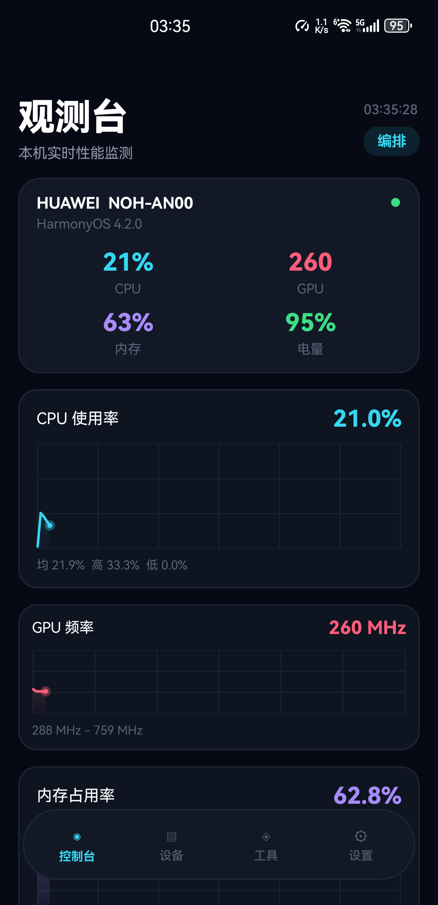
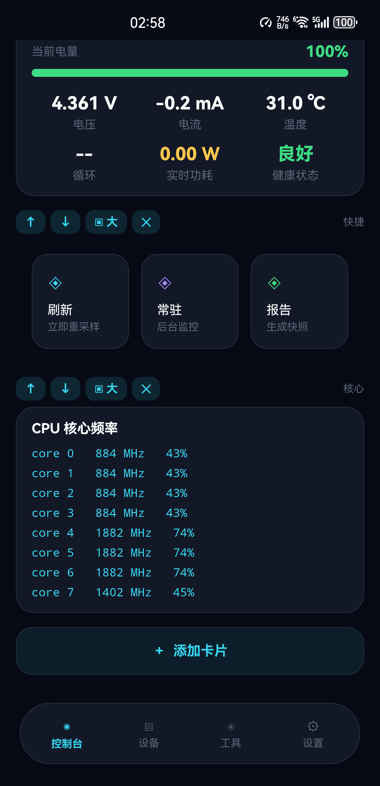
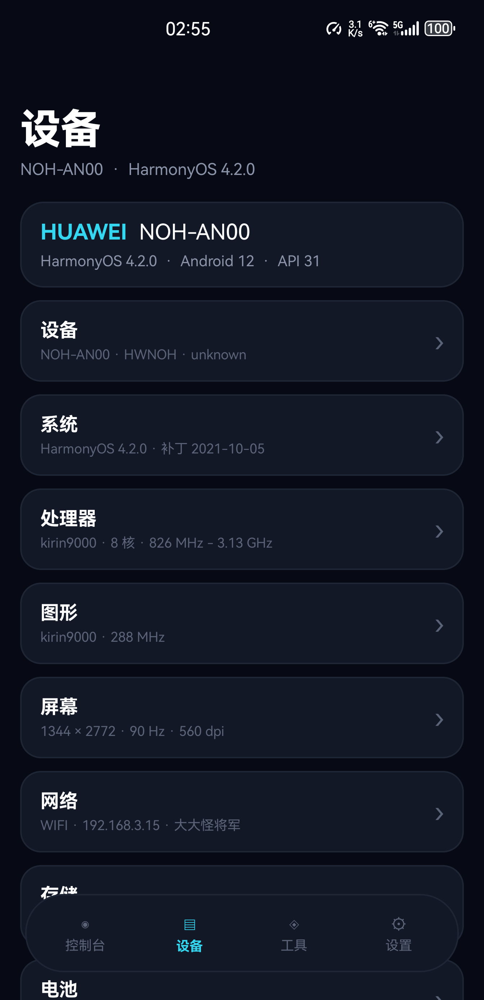
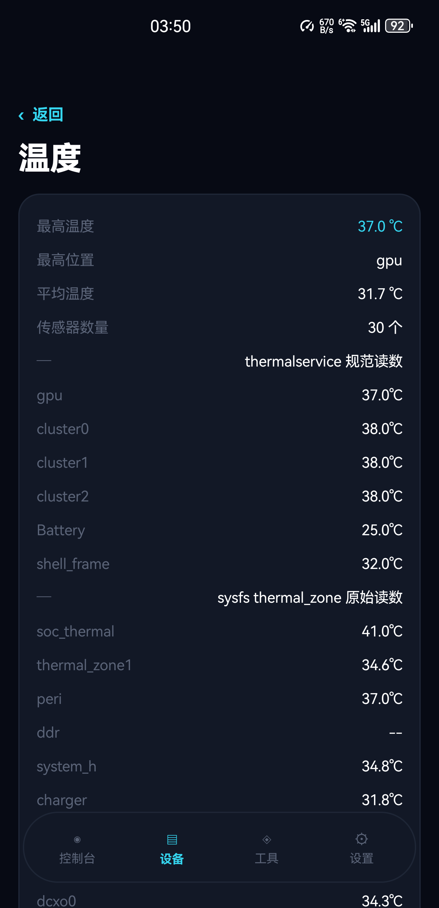
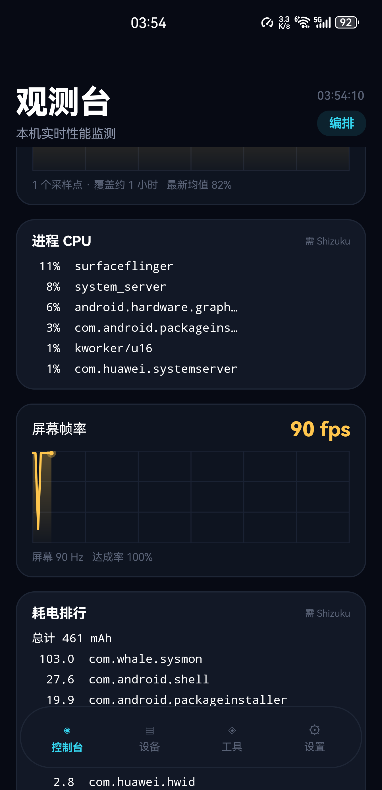
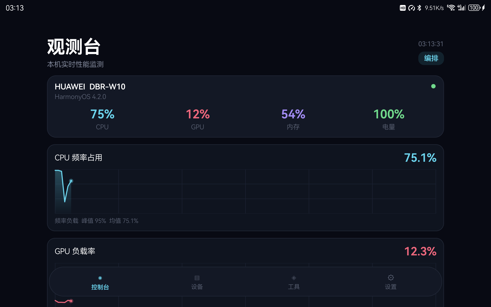

# 观测台 SysMon

一个零第三方依赖的 Android 设备信息与实时监控应用。不做广告、不做会员、不上传任何数据。

用纯命令行构建（`aapt2` + `javac` + `d8` + `zipalign` + `apksigner`），**不需要 Gradle，也不需要 Android Studio**。

> 起因是受够了市面上同类 App 的广告和会员墙，干脆自己写一个。视觉参考了 HarmonyOS 上的「系统观测台」，数据分组参考了「设备信息X」。

---

## 截图

| 控制台 | 卡片编排 |
|---|---|
|  |  |

| 设备分类 | 温度 |
|---|---|
|  |  |

| 耗电排行 | 平板横屏 |
|---|---|
|  |  |

---

## 功能

### 控制台（可自由编排）

18 种卡片，长按或点右上角「编排」进入编辑态：

- `↑` `↓` 调整顺序，`▣大` / `▤小` 切换大小（小卡一行两个），`✕` 删除
- 底部「＋ 添加卡片」从清单里选
- 布局存本地，重装之外都不会丢

卡片类型：概要、CPU 曲线、GPU 曲线、内存曲线、温度曲线、电池健康、CPU 核心频率、网络概览、存储占用、运行时、快捷操作、传感器列表、屏幕参数、网速曲线、电池详情、24 小时趋势、进程 CPU、屏幕帧率、耗电排行。

### 实时监控

- 曲线按采样间隔做**逐帧插值**，是连续滚动而不是每秒跳一格（实测 84fps，jank 1.29%）
- 支持 90Hz / 120Hz 高刷屏（`Window.setFrameRate`）
- 只在图表可见时重绘，切后台自动停

### 设备信息

13 个分类子菜单，约 100 个字段：

设备 / 系统 / 处理器 / 图形 / 屏幕 / 网络 / 存储 / 电池 / 温度 / 相机 / 硬件能力 / 传感器 / 应用

其中「硬件能力」是 36 项的勾叉表，「应用」列出全部包名。

### 后台常驻

- 前台服务 + 通知栏常显实时指标
- 三档阈值告警（CPU / 温度 / 内存），同一指标 10 分钟内只提醒一次
- 48 小时趋势：每小时聚合成一个点，本地持久化

---

## 构建

### 需要

- JDK 17
- Android SDK `build-tools`（含 `aapt2` / `d8` / `zipalign` / `apksigner`）与 `platforms/android-34`
- Windows PowerShell（脚本是 `.ps1`）

### 步骤

```powershell
# 改 build.ps1 顶部的 $BUILD_ROOT 指向你的 Android SDK 目录
powershell -ExecutionPolicy Bypass -File build.ps1
```

产物为 `SysMon.apk`。首次构建会自动生成 `sysmon.jks` 签名密钥（该文件已在 `.gitignore` 里，**不要提交**）。

构建流程：

```
aapt2 compile resources
  → aapt2 link（生成 R.java + base.apk）
  → javac --release 8
  → d8（argfile 传入，避免命令行超长）
  → 注入 classes.dex
  → zipalign
  → apksigner
```

---

## Shizuku 接入

这是本项目技术上最花时间的一块。

普通 App 跑在 `untrusted_app` 域下，`/proc/stat` 会被 SELinux 拦掉 —— 拿不到真实的 CPU 使用率。通过 [Shizuku](https://github.com/RikkaApps/Shizuku) 拿到 shell（uid 2000）权限后才行。

**但官方文档描述的接入方式和 13.x 的实际行为不一致**，这里是实测出来的：

### 1. 不是 bindService

文档里的 `bindService(moe.shizuku.server.ShizukuService)` 会直接返回 `false` —— 那个 Service 在 13.x 里已经不存在了。

实际模型是：**Shizuku server 主动把 binder 推到客户端的 ContentProvider**。

所以需要声明一个 provider：

```xml
<provider
    android:name=".data.ShizukuProvider"
    android:authorities="你的包名.shizuku"
    android:exported="true" />
```

然后 server 会调用它的 `call("sendBinder", ...)`，binder 放在 extras 的 `moe.shizuku.privileged.api.intent.extra.BINDER` 里（是个 `Parcelable`，类名必须是 `moe.shizuku.api.BinderContainer`）。

### 2. 必须先 attach

拿到 binder 后直接调 `checkSelfPermission()` 会抛：

```
IllegalStateException: Not an attached client
```

必须先 `attachApplication`。官方 Java 库这步走 hidden API（`SystemServiceHelper`），但协议本身很简单，`transact(18)` 就够了：

```java
Bundle args = new Bundle();
args.putInt("shizuku:attach-api-version", 13);
args.putString("shizuku:attach-package-name", packageName);

Parcel data = Parcel.obtain();
data.writeInterfaceToken("moe.shizuku.server.IShizukuService");
data.writeStrongBinder(app.asBinder());   // IShizukuApplication.Stub
data.writeInt(1);                          // Bundle 非空
args.writeToParcel(data, 0);
binder.transact(18, data, reply, 0);
```

那几个 Bundle key 是从 Shizuku 的 dex 里逐字提取出来的，不是猜的。

### 3. 拿到之后

```java
IRemoteProcess p = service.newProcess(new String[]{"sh", "-c", cmd}, null, null);
```

就能以 shell 身份执行任意命令了。

本项目用它读：`/proc/stat`（真实 CPU 使用率）、`dumpsys cpuinfo`（进程排行）、`dumpsys batterystats`（耗电排行）、`dumpsys SurfaceFlinger --latency`（帧率）、`dumpsys thermalservice`（规范温度）、`pm list packages`（应用清单）。

**没有 Shizuku 时全部优雅降级**，只是 CPU 曲线会退化成「核心频率占用」并如实标注。

`shizuku/aidl/` 下的 AIDL 定义来自 [RikkaApps/Shizuku-API](https://github.com/RikkaApps/Shizuku-API)（Apache-2.0），`shizuku/gen/` 是 `aidl` 工具生成的接口代码。

---

## 数据来源与已知限制

| 数据 | 来源 | 备注 |
|---|---|---|
| CPU 使用率 | `/proc/stat` 差分 | **需要 Shizuku**；否则退化为频率占用 |
| 核心频率 | `/sys/devices/system/cpu/cpuN/cpufreq/*` | 直接可读 |
| 内存 | `/proc/meminfo` | 直接可读 |
| GPU 频率 | `/sys/class/devfreq/gpufreq/*` | 单位是 Hz，需换算 |
| GPU 负载 | `kgsl/gpubusy` | 只有部分 SoC 暴露（骁龙有，麒麟没有） |
| 温度 | `thermal_zone*` + `dumpsys thermalservice` | 见下方「踩过的坑」 |
| 电池 | `BatteryManager` + `dumpsys battery` | 部分 ROM 的 `BatteryManager` 电流返回 0 |
| 屏幕 | `DisplayMetrics` / `Display.Mode` | 直接可读 |

### 拿不到的东西

- **电池循环次数**：`/sys/class/power_supply/Battery/cycle_count` 连 shell 都没权限，厂商锁了。市面上同类 App 显示的是软件估算，本项目如实显示 `--`。
- **`/sys/class/power_supply/*`**：普通 App 和 shell 都是 `Permission denied`，电流只能走 `BatteryManager`。

---

## 踩过的坑

**温度：`soc` 节点不是温度。** 高通平台有个 thermal zone 叫 `soc`，它返回的是**电量百分比**（97 = 97%），被当成 97℃ 直接顶到最高温度。同类的还有 `ibat-lvl0`（电流限值）、`vbat-lvl0`（电压 mV）、`bcl-lvl0`（无效负值）。现在做名字 + 数值双重过滤，只接受换算后 1~150℃ 的。

**温度：`ddr` 显示 -40℃。** Linux 温度传感器未初始化时的经典默认值，按 `--` 处理。

**进程名只显示首字母。** 正则用了 `(\S+?)` 懒惰匹配，只匹配一个字符。改贪婪再裁冒号。

**复用的 View 会崩。** 卡片重排时没把实例从旧父容器摘掉，`addView` 抛 `IllegalStateException: child already has a parent`。

**LayoutParams 不能共用。** 多个页面 `addView` 传同一个 `LayoutParams` 实例会被依次改写，导致布局错位。

**`File.canRead()` 会骗人。** SELinux 下 `access()` 可能返回 false 但 `open()` 是通的，判断读权限别用它。

---

## 项目结构

```
whale-sysmon/
├── AndroidManifest.xml
├── build.ps1                    # 七步构建脚本
├── src/
│   ├── com/whale/sysmon/
│   │   ├── MainActivity.java    # 壳：固定头 + 页面切换
│   │   ├── data/                # 数据层（Cpu/Mem/Bat/Thermal/Net/...）
│   │   ├── page/                # 四个页面
│   │   ├── ui/                  # 自绘控件（SparkChart/Meter/BottomNav）
│   │   └── monitor/             # 前台服务 + 告警
│   └── moe/shizuku/api/         # BinderContainer（与官方同名）
├── shizuku/
│   ├── aidl/                    # 来自 Shizuku-API（Apache-2.0）
│   └── gen/                     # aidl 生成的接口
├── res/
└── docs/screenshots/
```

## 实测环境

- 华为 Mate 40 Pro（Kirin 9000 / HarmonyOS 4.2 / 1344×2772 / 90Hz）
- 华为 MatePad DBR-W10（Snapdragon 865 / HarmonyOS 4.2 / 1600×2560）
- Shizuku 13.5

## 许可

MIT。`shizuku/aidl/` 下的接口定义版权归 [RikkaApps/Shizuku-API](https://github.com/RikkaApps/Shizuku-API) 所有，遵循 Apache-2.0。
